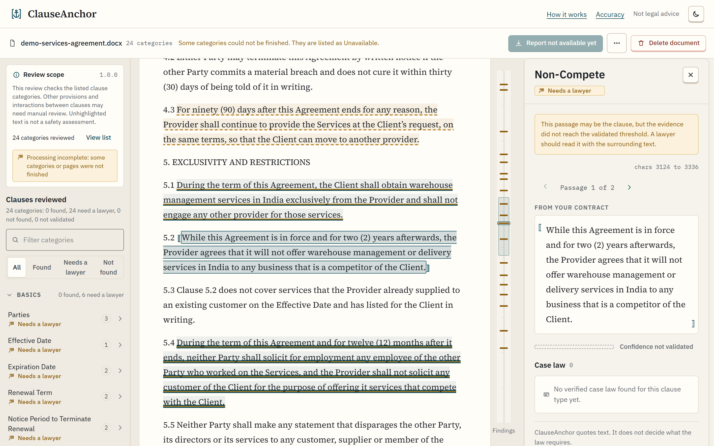
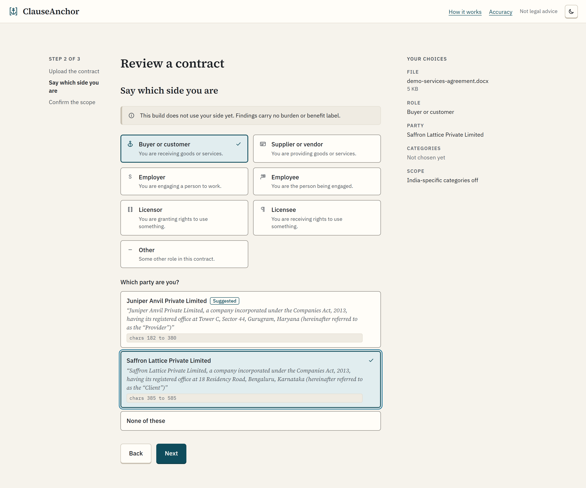
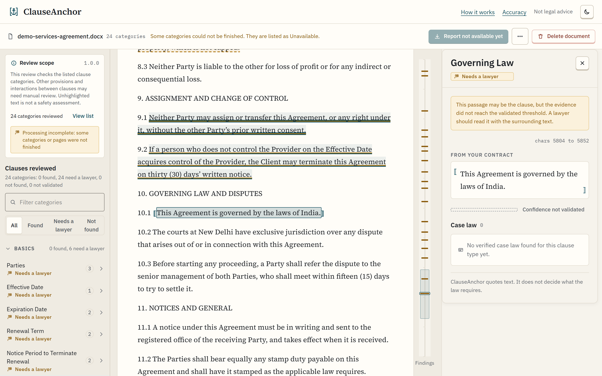
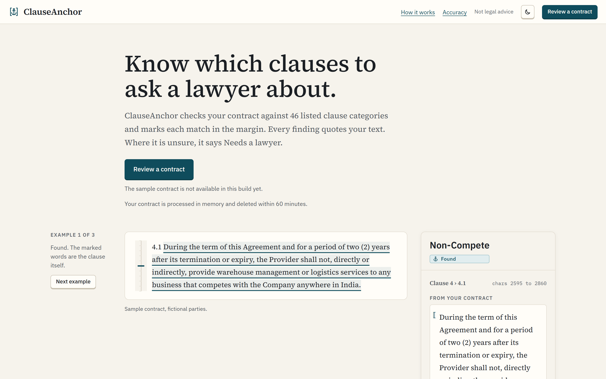
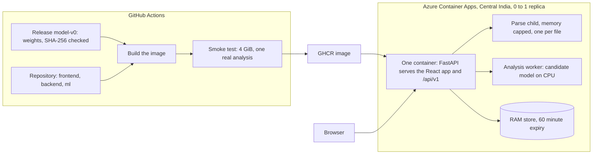

<h1 align="center">ClauseAnchor</h1>

<p align="center">
  <b>Reads a PDF or DOCX contract against a fixed list of clause categories, marks each match in the margin and quotes your own words.</b><br>
  Where the evidence is weak it says Needs a lawyer. It does not give advice.
</p>

<p align="center">
  <a href="https://clauseanchor.icystone-c7631062.centralindia.azurecontainerapps.io/">Live demo</a> ·
  <a href="#getting-started">Get started</a> ·
  <a href="#how-it-works">How it works</a> ·
  <a href="#results">Results</a> ·
  <a href="#architecture">Architecture</a> ·
  <a href="#limitations">Limitations</a> ·
  <a href="#roadmap">Roadmap</a>
</p>

<p align="center">
  <a href="https://clauseanchor.icystone-c7631062.centralindia.azurecontainerapps.io/"></a>
  
  
  
  
  
  
  
  <a href="LICENSE"></a>
</p>

---

## At a glance

| | |
|---|---|
| **Categories** | 46: 41 from CUAD and 5 India extensions. The five India categories are listed and not yet available |
| **Model** | RoBERTa-base (`FacebookAI/roberta-base`) fine-tuned for extractive question answering on CUAD. Release `clauseanchor-candidate-prototype-v0`, run on CPU |
| **Output** | Review candidates only: a quoted passage, exact character offsets, the status Needs a lawyer and no confidence figure |
| **Evaluation** | CUAD full official test, 102 contracts and 2,643 gold spans, scored on review candidates at an IoU of 0.5. Precision 21.984%, recall 67.991%, exact-match recall 56.300%, micro F1 33.225%, macro F1 35.226% |
| **Input** | PDF or DOCX with selectable text, up to 10 MiB, 100 PDF pages and 500,000 characters |
| **Your file** | Held in memory and deleted within 60 minutes, or at once with Delete document. The API writes no part of it to disk |
| **Hosting** | One Docker image on Azure Container Apps, Central India, 2 vCPU and 4 GiB, scaled from 0 to 1 replica |
| **Tests** | 1785 backend (27 skipped) and 135 frontend |

**Live demo:** https://clauseanchor.icystone-c7631062.centralindia.azurecontainerapps.io/

The app scales to zero, so the first visit after a quiet spell takes 1 to 3 minutes. The built-in sample contract is not available in this build yet, so upload a public or fictional agreement. Use sample contracts, not confidential ones.

## Overview

<p align="center">
  <a href="https://clauseanchor.icystone-c7631062.centralindia.azurecontainerapps.io/">
    <picture>
      <source media="(prefers-color-scheme: dark)" srcset="docs/assets/readme/reader-dark.png">
      
    </picture>
  </a>
</p>
<p align="center"><em>The Reader on a fictional services agreement, with the Non-Compete passage quoted from the contract and marked Needs a lawyer.</em></p>

A contract can run to dozens of pages, and CUAD defines 41 clause types to look for in one, from renewal terms to liability caps. A summary can invent text. A tool that stays silent about what it missed reads like a clean bill of health. ClauseAnchor marks where a listed clause type may be and quotes the exact words with their character offsets. When the evidence falls short of a validated threshold, it says Needs a lawyer.

Indian commercial contracts are the target. The catalogue carries five India extensions (arbitration, seat and venue, stamping and registration, forum selection, dispute escalation). Those five are not available yet, and the model learned from CUAD.

## How it works

1. **Upload.** The browser opens an anonymous session (a bearer token shown once, valid for 60 minutes at most) and sends one PDF or DOCX as a raw request body. The API checks size, emptiness and file type by magic bytes, then answers 202.
2. **Parse in a sandbox.** A queue hands the bytes to one worker, which parses each file in its own child process under a wall-clock kill and a memory cap. The API refuses a file that is encrypted, scanned throughout or carries tracked changes, with a fixed error code.
3. **Canonical text.** The parser returns one `source_text` with its SHA-256, text blocks, a structure tree (clauses, headings, schedules, definitions, tables, parties) and warnings. Offsets are Unicode code points with an exclusive end. The parser never normalises the text, so every highlight points into the same string. It marks a file it could read only in part as `partial`.
4. **Candidate model.** For the categories you choose, the analyzer puts one fixed question per category to the model and reads the text window by window on CPU. Progress is reported while it runs, and a cancel or the time limit stops it.
5. **Candidate policy.** Every span comes back as a `review_candidate` from the model with a null confidence. A processed category abstains, the five India categories are `unavailable`, and zero candidates never mean absence. The API checks each result before it stores it and never upgrades a status or fills in a confidence.
6. **Statuses.** The Reader shows Needs a lawyer, Confidence not validated and, when processing did not finish, Unavailable. Found and Not found exist as statuses, and in this build the model decides neither.
7. **The Reader.** The contract appears as paper with the findings underlined. A ruler strip beside it holds one tick per category, and a detail panel quotes the passage with its offsets.

<p align="center">
  <a href="https://clauseanchor.icystone-c7631062.centralindia.azurecontainerapps.io/">
    <picture>
      <source media="(prefers-color-scheme: dark)" srcset="docs/assets/readme/start-dark.png">
      
    </picture>
  </a>
</p>
<p align="center"><em>Step 2 of 3 on the fictional file: a side and a party are picked, and this build does not use them yet.</em></p>

<p align="center">
  <a href="https://clauseanchor.icystone-c7631062.centralindia.azurecontainerapps.io/">
    <picture>
      <source media="(prefers-color-scheme: dark)" srcset="docs/assets/readme/reader-review-dark.png">
      
    </picture>
  </a>
</p>
<p align="center"><em>Governing Law selected at characters 5804 to 5852, with the quoted evidence, the Needs a lawyer label and the candidate-only wording.</em></p>

## Design

The direction is called Marginalia: a finding looks like a careful reader's mark in the margin of a printed page. The rules below come from [`docs/app/DesignSystem.md`](docs/app/DesignSystem.md).

- **The contract is paper.** A warm off-white sheet (a dark one in dark mode), set in a serif face, left-aligned and never justified, at 68 to 80 characters a line.
- **A finding is an ink mark.** An underline with a faint tint, never a filled box, so the text stays legible. Overlapping findings stack their underlines.
- **Ochre is the colour of Needs a lawyer.** It is calm. It reads as "a person should look at this" and never signals danger.
- **Deep ink teal is the brand, the primary action and Found.** Found marks a validated decision only. No live finding earns it in this build, so every live finding is Needs a lawyer.
- **Brick marks technical failures and never a legal finding.** Nothing in the system is red for risk. There is no verdict colour, no score and no safety label.
- **A status is never colour alone.** Every status carries an icon and words, and a dashed outline marks Confidence not validated.
- **The margin is where findings live.** A ruler strip holds one tick per category at its first finding.
- **Three type roles.** Source Serif 4 for contract text and headings, IBM Plex Sans for the interface, IBM Plex Mono for offsets and hashes. All twelve font files are served from the app's own origin.
- **The voice describes and never judges.** "Needs a lawyer", "No clause found at the validated threshold" and "Confidence not validated" are fixed phrases. "Safe", "clear" and "risky" are not used.
- **Accessibility floors.** Text never drops below 12 px. Colour pairs meet WCAG AA, and a unit test asserts them. Hit areas are at least 44 px, and one reduced-motion block covers every animation.

<p align="center">
  <a href="https://clauseanchor.icystone-c7631062.centralindia.azurecontainerapps.io/">
    <picture>
      <source media="(prefers-color-scheme: dark)" srcset="docs/assets/readme/landing-dark.png">
      
    </picture>
  </a>
</p>
<p align="center"><em>The landing page above the fold; its hero example is a prepared quote from a fictional contract, and a live review returns Needs a lawyer only.</em></p>

## Features

- **Quotes, never paraphrases.** Every string on screen is quoted contract text or a short label. The app writes no legal text.
- **Exact offsets.** Each finding carries a start and an end into the canonical text, shown as `chars 3124 to 3336`.
- **Status without a verdict.** Needs a lawyer and Confidence not validated on every live finding. A fixed scope notice sits on every result: "Unhighlighted text is not a safety assessment."
- **46 listed categories.** Pick the ones to check in step 3 of the start flow, grouped under seven headings.
- **PDF and DOCX parsing.** PDF columns, headers, footers and page numbers (marked as decoration, never deleted). DOCX auto-numbering, tables, text boxes, headers, footers and footnotes.
- **Limits for hostile files.** One capped child process per parse, a 100-page limit, a decoded-content budget and archive checks against zip bombs.
- **It says when it read only part.** A scanned page, an embedded object or a form field with text sets `partial`. The Reader then says part of the document could not be read.
- **Private by default.** Memory only, 60-minute expiry, Delete document at any time, no cookies or local storage, and no request to a third party.
- **Reader navigation.** Keyboard stepping between passages, a clickable margin ruler, a passage counter and a category filter.
- **Accessible.** Contrast pairs tested, 44 px targets, a forced-colours fallback for the marks, reduced motion, and no axe violation in 154 captures during the frontend review.
- **Light and dark themes**, following the system setting with a toggle.
- **One image, tested before it ships.** The CI workflow runs a real analysis inside the container before it publishes.

## Results

These are the frozen final-evaluation figures for the candidate-only v0 release, copied from [`docs/ml/CUAD_FinalEvaluation.md`](docs/ml/CUAD_FinalEvaluation.md). Scoring is anchored: one-to-one matching with a character overlap (IoU) of at least 0.5, with exact boundaries counted separately.

| Slice | Candidates | Precision | Recall | Exact-match recall | Micro F1 | Macro F1 |
|---|---:|---:|---:|---:|---:|---:|
| Full official test (102 contracts, 99 families, 2,643 gold spans) | 8,174 | 21.984% | 67.991% | 56.300% | 33.225% | 35.226% |
| Known-overlap sensitivity (93 contracts, 2,441 gold spans) | 7,641 | 21.712% | 67.964% | 55.961% | 32.910% | 34.962% |

Descriptive 95% intervals on the full test, from a 2,000-replicate whole-family bootstrap: precision 19.618% to 24.766%, recall 65.581% to 70.329%, exact-match recall 53.750% to 58.877%.

**How to read them.** These are review candidates, not accepted findings. The decoder keeps every positive-margin span and sets no global cap, so the output favours recall. About two thirds of the gold spans are matched by a suggestion, and about four in five suggestions are not matches. Confidence is null and shown as "not validated". All 46 catalogue rows are `not_validated`, and the release switches off automatic acceptance and absence. An empty accepted set is not a quality pass. The evaluation ran on a GPU, and the hosted app runs the same weights on CPU. No time-saving claim is made.

**Where it falls short.** The measured weakness is noise.

- **False highlights.** 6,377 of the 8,174 candidates are false positives: 62.52 per contract on average, 198.25 at the 95th percentile and 597 at worst.
- **Unfinished questions.** 1,176 of 4,182 category questions are processing-incomplete: 1,122 had the question cut to its first 64 tokens, 68 had boundary flags and 14 had both.
- **Silent misses.** 2,242 questions returned no candidate, and 36 of them had a gold span. Zero output never means absence.
- **Thin support.** 16 of the 41 measured categories have sparse support, and the other 25 pass the support rule but are not validated.
- **No per-category figures yet.** The breakdown sits in the frozen report, which is kept outside git, so this README names no weak category. The Accuracy page will show it after Phase 3-C.

<details>
<summary>Official benchmark path (not the deployed analyzer)</summary>

The same exported checkpoint weights that the app runs, scored through the CUAD authors' reference inference and scoring path on the full test. These numbers are not the accuracy of the analyzer that serves the app.

| Weights | Official AUPR | Official P@80R | Official P@90R |
|---|---:|---:|---:|
| Clean checkpoint | 43.635% | 0.000% | 0.000% |
| Authors' released reference | 42.586% | 31.131% | 0.000% |

The clean checkpoint's AUPR is 1.049 percentage points higher, which does not show it is better: its P@80R is worse and the training data differs. The 0.000% P@80R comes from the unchanged evaluator, which leaves the last curve point out of its lookup, and it does not mean zero correct predictions.

</details>

## Architecture

One origin: the React app and `/api/v1` come from one FastAPI server in one image. GitHub Actions builds the image, smoke-tests it and publishes it to GHCR, and Azure Container Apps runs it scaled from 0 to 1.



```text
backend/                     FastAPI app, parser and tests
  app/parsing/               pdf.py, docx.py, structure.py, parties.py: text, offsets, clause tree
  app/api/                   routes, the error envelope, the bearer check
  app/services/              store.py, parse_jobs.py, analysis_jobs.py, memcap.py, analysis.py
  app/scripts/               parse_file.py, export_openapi.py, smoke_test.py (the CI check)
  tests/                     the backend suite; fixtures are generated at test time
frontend/                    React app (hash router, pnpm)
  src/pages/                 Landing, Start, Reader, HowItWorks, Accuracy
  src/api/                   http.ts adapter, errors.ts error table, catalogue.ts
  src/index.css              design tokens, light and dark
ml/                          analysis core and the records of how the model was built
  clauseanchor_core/         the analyzer, artifact checks and the result contract
  configs/catalogue.json     the 46 categories
docs/
  app/                       Architecture, API, DesignSystem, Phases, BuildLog, Deploy, Development
  ml/                        evaluation, release and catalogue records
  assets/readme/             the screenshots in this file
data/raw/cuad/               the CUAD source file's provenance and license notes
deploy/azure-containerapp.yaml   the Azure app spec
.github/workflows/image.yml  build, smoke test and publish
Dockerfile                   two stages: frontend build, then the Python runtime and model
```

## Tech stack

| Layer | Choices |
|---|---|
| Backend | Python 3.12, FastAPI 0.143.3, uvicorn 0.54.0, Pydantic 2.14.1, SQLite from the standard library |
| Parsing | pdfplumber 0.11.10 (pdfminer.six), python-docx 1.2.0 (lxml 6.1.3) |
| Model | RoBERTa-base fine-tuned on CUAD, PyTorch 2.9.1 on CPU, Transformers 4.57.6 |
| Frontend | React 19.2.4, TypeScript 5.9.3 (strict), Vite 8.0.5, Tailwind CSS 4.2.2, react-router 8.4.0, pnpm |
| Fonts | Source Serif 4, IBM Plex Sans, IBM Plex Mono (SIL OFL 1.1), self-hosted |
| Tests | pytest 9.1.1, httpx 0.28.1, ruff 0.16.10, and Node's built-in test runner for the frontend |
| Delivery | Docker, GitHub Actions, GitHub Container Registry, Azure Container Apps |

**Deliberate choices.**

- **In-memory sessions and SQLite `:memory:`.** The promise is deletion within 60 minutes, so nothing durable is stored. SQLite holds metadata only (ids, token hashes, timestamps, sizes, job state).
- **One container, one origin, no CORS.** No proxy and no second service to run.
- **Candidate-only output.** No verdict, no risk score, no confidence figure.
- **Standard library first.** No ORM, queue broker or settings library. Parse and analysis each run on one worker thread.
- **A hash router**, so the app runs on any static host with no rewrite rules.

## Getting started

**Hosted.** Open the [live demo](https://clauseanchor.icystone-c7631062.centralindia.azurecontainerapps.io/), choose Review a contract, upload a PDF or DOCX, pick the categories and start the review. Expect 1 to 3 minutes on the first visit after idle. Use sample contracts, not confidential ones.

**Local.** Needs Python 3.12 and Node 22.18 or later with pnpm 10 or later. Commands run from the repository root.

1. Install the backend.

   ```bash
   cd backend
   python -m venv .venv
   source .venv/Scripts/activate
   pip install -r requirements-dev.txt -c constraints.txt
   ```

2. Start the API from `backend/` with the virtual environment active. It runs the stub analyzer by default, which answers every upload with 409 `SAMPLE_MODE_ONLY`. Real mode needs the v0 model bundle (about 486 MiB, a release asset that never enters git), described under "Real mode" in the development guide.

   ```bash
   uvicorn app.main:create_app --factory --host 127.0.0.1 --port 8000
   ```

3. In a second terminal, install and start the frontend, then open http://127.0.0.1:5173.

   ```bash
   cd frontend
   pnpm install --frozen-lockfile
   pnpm dev
   ```

4. Run the checks from the repository root. The backend ones need the virtual environment from step 1.

   ```bash
   cd backend && ruff format --check . && ruff check . && pytest
   cd ../frontend && pnpm typecheck && pnpm test && pnpm build && pnpm check:dist
   ```

The full setup, with real mode, the environment variables and the command-line parser, is in [`docs/app/Development.md`](docs/app/Development.md). Deployment is in [`docs/app/Deploy.md`](docs/app/Deploy.md). The API contract is in [`docs/app/API.md`](docs/app/API.md).

## Design decisions

**Why quote exact spans instead of summarising?** A summary is new text, and new text can be wrong. The app writes no legal text. Every string on screen is quoted contract text or a short label, and every highlight, report line and flag points into one canonical string by offset. See `docs/app/Architecture.md` (key decisions, canonical text) and `docs/app/DesignSystem.md` section 1.

**Why candidates with null confidence instead of a score?** The calibration step failed its predeclared bin-gap check. The release records that its out-of-fold Brier score (0.103406) and ECE (0.040156) do not override that or justify probabilities, and it keeps automatic acceptance and absence disabled. See `docs/ml/ReleaseHandoff.md` section 1.

**Why "Needs a lawyer" instead of a guess?** A highlight-free passage is not a safe passage. An absent result for one category is never rolled up into a statement about the whole contract. When the evidence is close, the app shows the text and does not decide. See the review scope in `docs/app/Phases.md` and `docs/app/DesignSystem.md` section 4.

**Why a parse child with a memory cap instead of parsing inside the API?** A 16 KB file can decode to 16 MB and take minutes to extract, so a size check cannot bound it. A child process can be killed on a clock and held to a memory cap. Its error output goes nowhere, so library messages cannot carry document text into a log. See `docs/app/Architecture.md` (PDF content budget, parse child, memory cap).

**Why one origin instead of a separate API host?** It removes CORS, a proxy and a second service to run or pay for. The decision is recorded as R17 in `docs/app/Phases.md` (4-C1) and in `docs/app/Architecture.md` section 8.1.

**Why pdfplumber instead of PyMuPDF?** PyMuPDF is AGPL, which conflicts with this repository's MIT license and with a hosted demo. See `docs/app/Architecture.md` (key decisions, PDF library).

## Limitations

1. **Not legal advice.** ClauseAnchor points to text in your contract and does not say what the law requires. Unhighlighted text is not a safety assessment.
2. **Confidence is not validated.** All 46 categories are `not_validated`. Every finding is a review candidate with no confidence figure, so this build shows no Found result and no Not found result.
3. **The output is noisy.** About four in five candidates are not matches, a contract averages 62.52 false highlights, and 1,176 of 4,182 questions were processing-incomplete in the evaluation. No time-saving claim is made.
4. **Some features are not in this build.** Party binding and polarity, the PDF report, the Accuracy figures, the sample contract and the manual-review list belong to Phase 3. The app marks each as not available.
5. **Narrow input.** English text in a PDF or DOCX with selectable text. CUAD, an English-language dataset, supplied the fine-tuning data and the test set, so the figures cover no other language. The API refuses a file that is scanned throughout, password protected or carries tracked changes. The limits are 10 MiB and 100 PDF pages.
6. **The evaluation is CUAD only.** The five India categories are listed, unavailable and have no measured figures.
7. **A public demo with small limits.** Cold starts take 1 to 3 minutes. One replica holds every session in memory, and a restart empties it. The API allows 25 live sessions with 5 documents each, and there is no per-client rate limit.
8. **The landing hero is a prepared example.** It shows a Found status on a fictional contract. Live reviews return Needs a lawyer only.

ClauseAnchor is a research prototype. Do not rely on it for a decision about a real contract; ask a lawyer.

## Roadmap

**Done**

- [x] PDF and DOCX parser with exact offsets and a clause tree (Phase 1)
- [x] API for sessions, uploads, parse jobs and analyses (Phase 2)
- [x] Frontend: landing, start flow, Reader, How it works and Accuracy
- [x] One image, a CI smoke test and a live deployment on Azure Container Apps (Phase 4-B)

**Near term**

- [ ] Party binding and polarity (3-A)
- [ ] PDF review report (3-B)
- [ ] Evaluations endpoint behind the Accuracy page, and the sample contract (3-C)
- [ ] Manual-review list for text without findings (3-D)
- [ ] End-to-end check on a public contract and a CPU benchmark on the host (4-C)

**Mid term**

- [ ] Weigh the open dependency advisories on the pinned torch and Transformers versions (4-A)
- [ ] Response-header policy and the other review items left for the phase review (4-R)
- [ ] A retrain, deferred for now. Candidates: DeBERTa-v3-base, hard negatives and per-category thresholds

**Long term**

- [ ] Rules and retrieval for the five India categories, statute flags and judgment passages (deferred)
- [ ] ONNX int8 export, if its output matches the PyTorch model on fixed examples

## Acknowledgements

- **CUAD**, the Contract Understanding Atticus Dataset, curated by [The Atticus Project](https://www.atticusprojectai.org/cuad/) and released under [CC BY 4.0](https://creativecommons.org/licenses/by/4.0/). Research authors: Dan Hendrycks, Collin Burns, Anya Chen and Spencer Ball ([arXiv:2103.06268](https://arxiv.org/abs/2103.06268)). The dataset keeps its own license, and no endorsement by its creators is implied.
- **RoBERTa-base**, the base model, published as [`FacebookAI/roberta-base`](https://huggingface.co/FacebookAI/roberta-base) on Hugging Face.
- **Libraries:** PyTorch, Hugging Face Transformers, FastAPI, Pydantic, pdfplumber with pdfminer.six, python-docx, React, Vite, Tailwind CSS, and the Source Serif 4 and IBM Plex fonts.

## License

MIT. See [LICENSE](LICENSE).

<p align="center">
  Built by <a href="https://github.com/TheMEGALODON55681">Aryan Sharma</a> · 2026<br>
  <a href="https://www.linkedin.com/in/aryan-sharma-19906441b/">LinkedIn</a>
</p>
