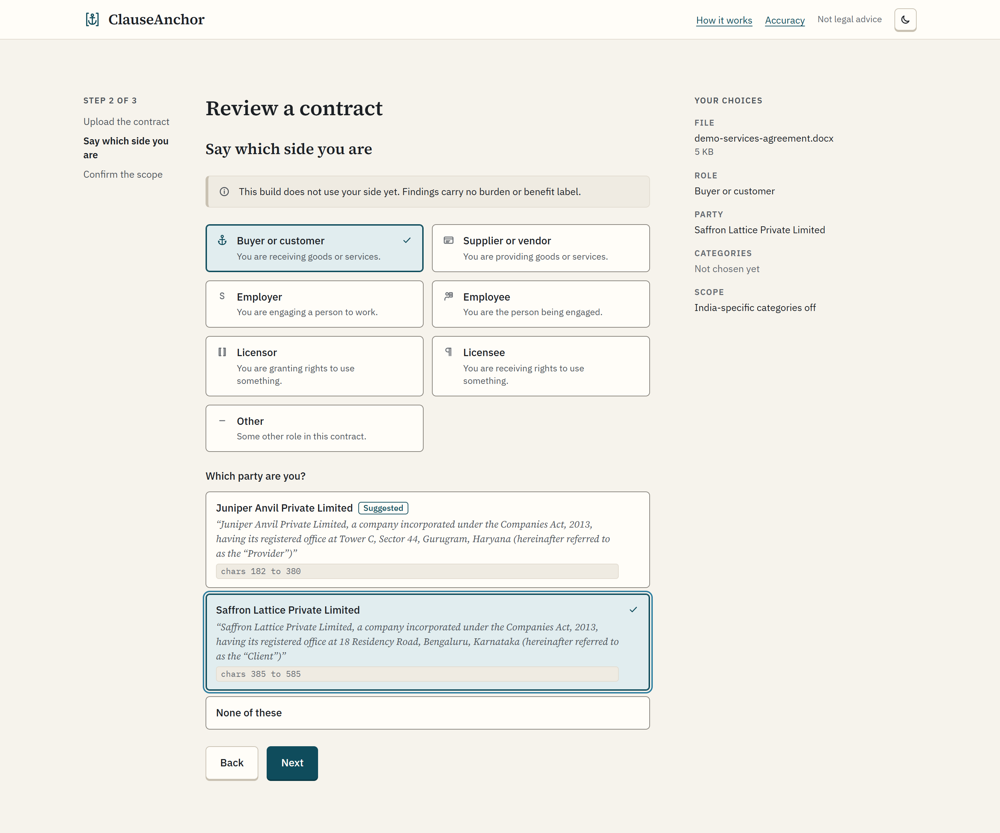
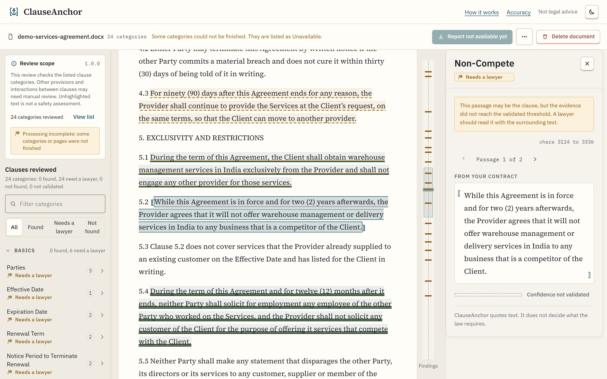
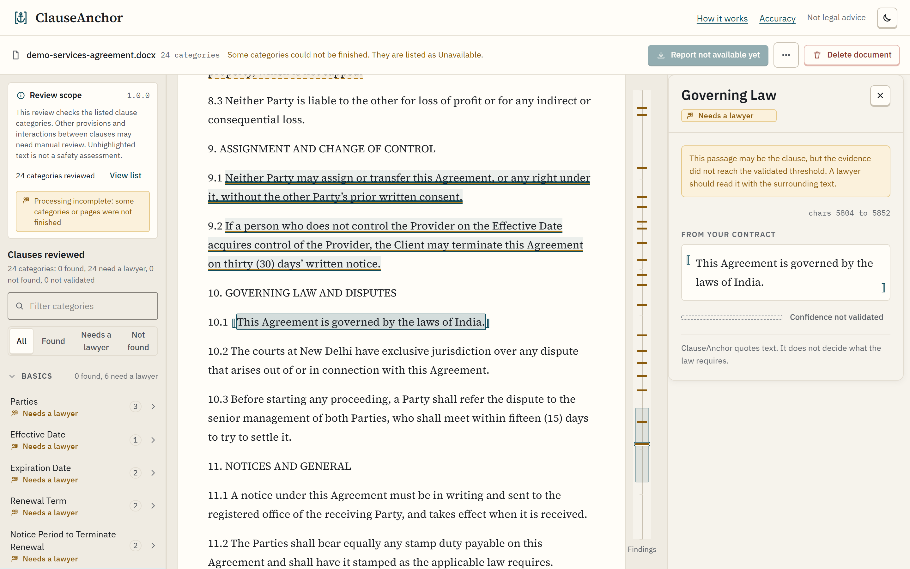
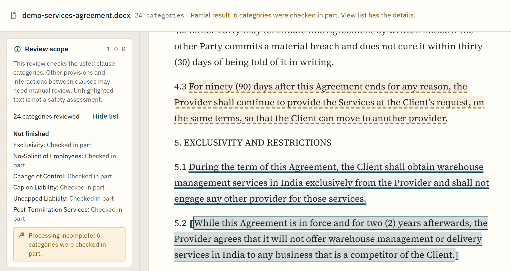
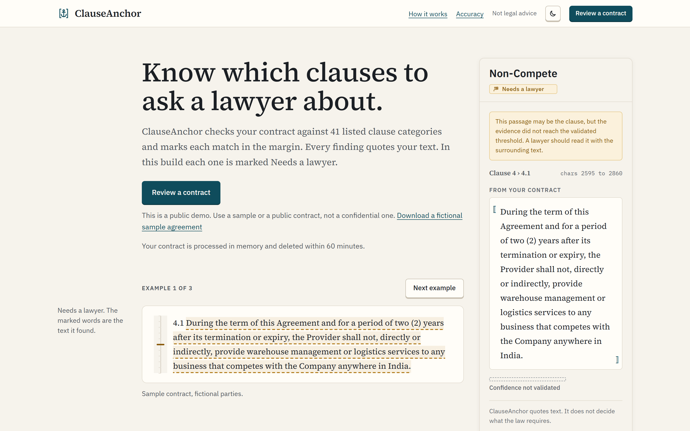
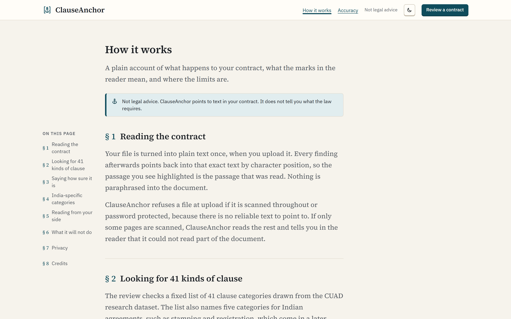
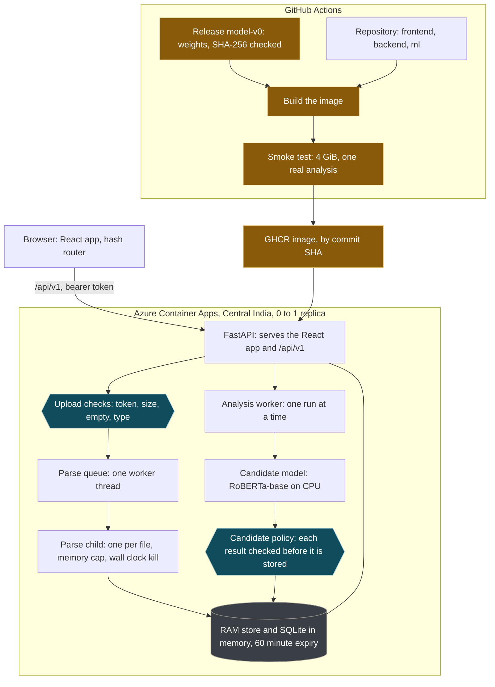
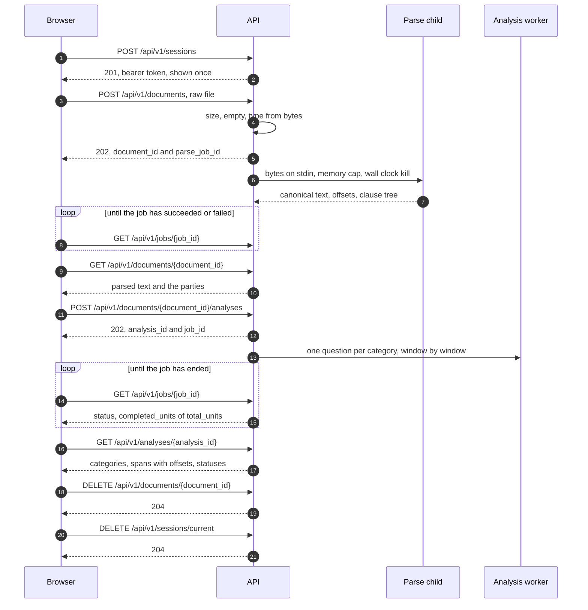

<h1 align="center">ClauseAnchor</h1>

<p align="center">
  <b>Reads a PDF or DOCX contract against a fixed list of clause categories, marks each match in the margin and quotes your own words.</b><br>
  Where the evidence is weak it says Needs a lawyer. It does not give advice.
</p>

<p align="center">
  <a href="https://clauseanchor.icystone-c7631062.centralindia.azurecontainerapps.io/">Live demo</a> ·
  <a href="#a-live-session">Live session</a> ·
  <a href="#getting-started">Get started</a> ·
  <a href="#how-it-works">How it works</a> ·
  <a href="#what-it-refuses">Refusals</a> ·
  <a href="#results">Results</a> ·
  <a href="#by-the-numbers">Numbers</a> ·
  <a href="#architecture">Architecture</a> ·
  <a href="#design-decisions">Design decisions</a> ·
  <a href="#limitations">Limitations</a> ·
  <a href="#roadmap">Roadmap</a>
</p>

<p align="center">
  <a href="https://clauseanchor.icystone-c7631062.centralindia.azurecontainerapps.io/"></a>
  <a href="https://github.com/TheMEGALODON55681/clauseanchor/actions/workflows/image.yml"></a>
  
  
  
  
  
  
  
  <a href="LICENSE"></a>
</p>

---

<p align="center">
  
</p>
<p align="center"><em>One session on the live app, replayed from real captures with the timing compressed: the review took 47 seconds and is shown in about 4. The agreement is fictional, and it is deleted at the end with the app's own button.</em></p>

## At a glance

| | |
|---|---|
| **Categories** | 46: 41 from CUAD and 5 India extensions. The five India categories are listed and not yet available |
| **Model** | RoBERTa-base (`FacebookAI/roberta-base`) fine-tuned for extractive question answering on CUAD. Release `clauseanchor-candidate-prototype-v0`, run on CPU |
| **Output** | Review candidates only: a quoted passage, exact character offsets, the status Needs a lawyer and no confidence figure |
| **Evaluation** | CUAD full official test, 102 contracts and 2,643 gold spans, scored on review candidates at an IoU of 0.5. Precision 21.984%, recall 67.991%, exact-match recall 56.300%, micro F1 33.225%, macro F1 35.226% |
| **Input** | PDF or DOCX with selectable text, up to 10 MiB, 100 PDF pages and 500,000 characters |
| **Your file** | Held in memory and deleted within 60 minutes, or at once with Delete document. The API writes no part of it to disk |
| **Hosting** | One Docker image on Azure Container Apps, Central India, 2 vCPU and 4 GiB, scaled from 0 to 1 replica |
| **Code** | Python: 17,298 lines in 84 source files and 19,356 in 66 test files. TypeScript: 9,668 lines in 88 source files and 1,810 in 17 test files. Physical lines in git-tracked files, counted by script |
| **Tests** | 1788 backend (27 skipped) and 179 frontend, run on the author's machine |
| **CI** | One workflow, `image`, started by hand or by a `v*` tag. It checks the model's SHA-256, builds the image, runs one real analysis in a 4 GiB, 2 CPU container and only then publishes to GHCR. It does not run the test suites |

**Live demo:** https://clauseanchor.icystone-c7631062.centralindia.azurecontainerapps.io/

The app scales to zero, so the first visit after a quiet spell takes 1 to 3 minutes. The built-in sample contract is not available in this build yet. The landing page and the first step link a fictional sample agreement to download and upload, or you can upload a public one. This is a public demo, so use sample contracts, not confidential ones.

## Overview

<p align="center">
  <a href="https://clauseanchor.icystone-c7631062.centralindia.azurecontainerapps.io/">
    <picture>
      <source media="(prefers-color-scheme: dark)" srcset="docs/assets/readme/reader-dark.png">
      
    </picture>
  </a>
</p>
<p align="center"><em>The Reader after a 24-category review of a fictional agreement. All 24 categories need a lawyer and none is Found. The panel quotes the Non-Compete passage with its offsets, and the toolbar says the result is partial.</em></p>

A contract can run to dozens of pages, and CUAD defines 41 clause types to look for in one, from renewal terms to liability caps. A summary can invent text. A tool that stays silent about what it missed reads like a clean bill of health. ClauseAnchor marks where a listed clause type may be and quotes the exact words with their character offsets. When the evidence falls short of a validated threshold, it says Needs a lawyer. When a review is only partly done, it says that too, and names what it left out.

Indian commercial contracts are the target. The catalogue carries five India extensions (arbitration, seat and venue, stamping and registration, forum selection, dispute escalation). Those five are not available yet, and the model learned from CUAD.

## A live session

Each image below is a capture of the live app, taken on 24 and 25 November 2026 on one fictional agreement that the app deleted afterwards.

**1. Upload and choose your side.** The app opens an anonymous session, uploads the file and finds the parties in it. You pick a role and a party. This build does not use them yet, and the page says so.

<p align="center">
  <a href="https://clauseanchor.icystone-c7631062.centralindia.azurecontainerapps.io/">
    <picture>
      <source media="(prefers-color-scheme: dark)" srcset="docs/assets/readme/start-dark.png">
      
    </picture>
  </a>
</p>

**2. Read a finding in the margin.** Pick a category and the panel quotes its passage, gives the characters it spans and says Confidence not validated.

<p align="center">
  <a href="https://clauseanchor.icystone-c7631062.centralindia.azurecontainerapps.io/">
    <picture>
      <source media="(prefers-color-scheme: dark)" srcset="docs/assets/readme/reader-dark.png">
      
    </picture>
  </a>
</p>

**3. See where a lawyer should look.** Governing Law is selected. The panel says the passage may be the clause but did not reach the validated threshold, and that a lawyer should read it with the surrounding text.

<p align="center">
  <a href="https://clauseanchor.icystone-c7631062.centralindia.azurecontainerapps.io/">
    <picture>
      <source media="(prefers-color-scheme: dark)" srcset="docs/assets/readme/reader-review-dark.png">
      
    </picture>
  </a>
</p>

**4. See what the review left out.** A category whose search did not finish counts as checked in part. The toolbar and the Review scope card show the count, and View list lists each one. Here six of the 24 were checked in part.

<p align="center">
  <a href="https://clauseanchor.icystone-c7631062.centralindia.azurecontainerapps.io/">
    <picture>
      <source media="(prefers-color-scheme: dark)" srcset="docs/assets/readme/partial-dark.png">
      
    </picture>
  </a>
</p>

## How it works

1. **Upload.** The browser opens an anonymous session (a bearer token shown once, valid for 60 minutes at most) and sends one PDF or DOCX as a raw request body. The API checks size, emptiness and file type by magic bytes, then answers 202.
2. **Parse in a sandbox.** A queue hands the bytes to one worker, which parses each file in its own child process under a wall-clock kill and a memory cap. The API refuses a file that is encrypted, scanned throughout or carries tracked changes, with a fixed error code.
3. **Canonical text.** The parser returns one `source_text` with its SHA-256, text blocks, a structure tree (clauses, headings, schedules, definitions, tables, parties) and warnings. Offsets are Unicode code points with an exclusive end. The parser never normalises the text, so every highlight points into the same string. It marks a file it could read only in part as `partial`.
4. **Candidate model.** For the categories you choose, the analyzer puts one fixed question per category to the model and reads the text window by window on CPU. Progress is reported while it runs, and a cancel or the time limit stops it.
5. **Candidate policy.** Every span comes back as a `review_candidate` from the model with a null confidence. A processed category abstains, the five India categories are `unavailable`, and zero candidates never mean absence. The API checks each result before it stores it and never upgrades a status or fills in a confidence.
6. **Statuses.** The Reader shows Needs a lawyer and Confidence not validated on every finding. When a review ends partial, the toolbar and the scope card say what it left out: categories checked in part, categories not checked and pages that could not be read, and View list names each one. Found and Not found exist as statuses, and in this build the model decides neither.
7. **The Reader.** The contract appears as paper with the findings underlined. A ruler strip beside it holds one tick per category, and a detail panel quotes the passage with its offsets.

## What it refuses

<p align="center"></p>
<p align="center"><em>Animated from real API responses on synthetic files, recorded on 25 November 2026. The memory cap and the wall-clock kill of the parse child are drawn as limits, not as a run.</em></p>

The API runs its upload checks in a fixed order and stops at the first that fails: the bearer token, the size (a body is counted as it arrives and stops at 10 MiB plus one byte), an empty body, then the file type, read from the bytes. A file that passes gets 202 and a parse job. The parser's own refusals come after that, as a failed job with a fixed code and message that never carries document text. The parse child runs under a 1,536 MiB memory cap and a 120 second wall-clock kill. [`docs/app/API.md`](docs/app/API.md) states those two limits, and this recording did not trigger them.

<p align="center">
  <picture>
    <source media="(prefers-color-scheme: dark)" srcset="docs/assets/readme/refusals-dark.png">
    
  </picture>
</p>

The files are the fictional agreement, three made from a few bytes (an empty file, PNG data named photo.pdf, and a PDF header padded to 10 MiB plus one byte) and three that the repository's own test builders make. Every document and the session were deleted afterwards.

## Results

These are the frozen final-evaluation figures for the candidate-only v0 release, copied from [`docs/ml/CUAD_FinalEvaluation.md`](docs/ml/CUAD_FinalEvaluation.md). Scoring is anchored: one-to-one matching with a character overlap (IoU) of at least 0.5, with exact boundaries counted separately.

| Slice | Candidates | Precision | Recall | Exact-match recall | Micro F1 | Macro F1 |
|---|---:|---:|---:|---:|---:|---:|
| Full official test (102 contracts, 99 families, 2,643 gold spans) | 8,174 | 21.984% | 67.991% | 56.300% | 33.225% | 35.226% |
| Known-overlap sensitivity (93 contracts, 2,441 gold spans) | 7,641 | 21.712% | 67.964% | 55.961% | 32.910% | 34.962% |

Descriptive 95% intervals on the full test, from a 2,000-replicate whole-family bootstrap: precision 19.618% to 24.766%, recall 65.581% to 70.329%, exact-match recall 53.750% to 58.877%.

**How to read them.** These are review candidates, not accepted findings. The decoder keeps every positive-margin span and sets no global cap, so the output favours recall. About two thirds of the gold spans are matched by a suggestion, and about four in five suggestions are not matches. Confidence is null and shown as "not validated". All 46 catalogue rows are `not_validated`, and the release switches off automatic acceptance and absence. An empty accepted set is not a quality pass. The evaluation ran on a GPU, and the hosted app runs the same weights on CPU. No time-saving claim is made.

**Where it falls short.** The measured weakness is noise.

- **False highlights.** 6,377 of the 8,174 candidates are false positives: 62.52 per contract on average, 198.25 at the 95th percentile and 597 at worst.
- **Unfinished questions.** 1,176 of 4,182 category questions are processing-incomplete: 1,122 had the question cut to its first 64 tokens, 68 had boundary flags and 14 had both.
- **Silent misses.** 2,242 questions returned no candidate, and 36 of them had a gold span. Zero output never means absence.
- **Thin support.** 16 of the 41 measured categories have sparse support, and the other 25 pass the support rule but are not validated.
- **No per-category figures yet.** The breakdown sits in the frozen report, which is kept outside git, so this README names no weak category. The Accuracy page will show it after Phase 3-C.

<details>
<summary>Official benchmark path (not the deployed analyzer)</summary>

The same exported checkpoint weights that the app runs, scored through the CUAD authors' reference inference and scoring path on the full test. These numbers are not the accuracy of the analyzer that serves the app.

| Weights | Official AUPR | Official P@80R | Official P@90R |
|---|---:|---:|---:|
| Clean checkpoint | 43.635% | 0.000% | 0.000% |
| Authors' released reference | 42.586% | 31.131% | 0.000% |

The clean checkpoint's AUPR is 1.049 percentage points higher, which does not show it is better: its P@80R is worse and the training data differs. The 0.000% P@80R comes from the unchanged evaluator, which leaves the last curve point out of its lookup, and it does not mean zero correct predictions.

</details>

## By the numbers

<p align="center">
  <picture>
    <source media="(prefers-color-scheme: dark)" srcset="docs/assets/readme/numbers-dark.png">
    
  </picture>
</p>

The test counts come from the part entries in [`docs/app/BuildLog.md`](docs/app/BuildLog.md) and [`docs/app/Phases.md`](docs/app/Phases.md), and a frontend count appears only where a part recorded one. The cold start is the figure in [`docs/app/Deploy.md`](docs/app/Deploy.md), reported and not measured. [`docs/app/ReadmeClaims.md`](docs/app/ReadmeClaims.md) traces every number in this README to its source.

## Design

The direction is called Marginalia: a finding looks like a careful reader's mark in the margin of a printed page. The rules below come from [`docs/app/DesignSystem.md`](docs/app/DesignSystem.md).

- **The contract is paper.** A warm off-white sheet (a dark one in dark mode), set in a serif face, left-aligned and never justified, at 68 to 80 characters a line.
- **A finding is an ink mark.** An underline with a faint tint, never a filled box, so the text stays legible. Overlapping findings stack their underlines.
- **Ochre is the colour of Needs a lawyer.** It is calm. It reads as "a person should look at this" and never signals danger.
- **Deep ink teal is the brand, the primary action and Found.** Found marks a validated decision only. No live finding earns it in this build, so every live finding is Needs a lawyer.
- **Brick marks technical failures and never a legal finding.** Nothing in the system is red for risk. There is no verdict colour, no score and no safety label.
- **A status is never colour alone.** Every status carries an icon and words, and a dashed outline marks Confidence not validated.
- **The margin is where findings live.** A ruler strip holds one tick per category at its first finding.
- **Three type roles.** Source Serif 4 for contract text and headings, IBM Plex Sans for the interface, IBM Plex Mono for offsets and hashes. All twelve font files are served from the app's own origin.
- **The voice describes and never judges.** "Needs a lawyer", "No clause found at the validated threshold" and "Confidence not validated" are fixed phrases. "Safe", "clear" and "risky" are not used.
- **Accessibility floors.** Text never drops below 12 px. Colour pairs meet WCAG AA, and a unit test asserts them. Hit areas are at least 44 px, and one reduced-motion block covers every animation.

<p align="center">
  <a href="https://clauseanchor.icystone-c7631062.centralindia.azurecontainerapps.io/">
    <picture>
      <source media="(prefers-color-scheme: dark)" srcset="docs/assets/readme/landing-dark.png">
      
    </picture>
  </a>
</p>
<p align="center"><em>The landing page above the fold. The hero example quotes a fictional contract and shows what a live review returns: Needs a lawyer, with Confidence not validated.</em></p>

<p align="center">
  <a href="https://clauseanchor.icystone-c7631062.centralindia.azurecontainerapps.io/#/how-it-works">
    <picture>
      <source media="(prefers-color-scheme: dark)" srcset="docs/assets/readme/how-it-works-dark.png">
      
    </picture>
  </a>
</p>
<p align="center"><em>The How it works page: what happens to a contract, what the marks mean and where the limits are.</em></p>

## Features

- **Quotes, never paraphrases.** Every string on screen is quoted contract text or a short label. The app writes no legal text.
- **Exact offsets.** Each finding carries a start and an end into the canonical text, shown as `chars 3124 to 3336`.
- **Status without a verdict.** Needs a lawyer and Confidence not validated on every live finding. A fixed scope notice sits on every result: "Unhighlighted text is not a safety assessment."
- **It says what it left out.** A partial result names the categories checked in part, the categories not checked and the pages it could not read, in View list.
- **46 listed categories, 41 that run.** Pick the ones to check in step 3 of the start flow, grouped under seven headings. The five India categories are not available in this build, and the Reader says so.
- **PDF and DOCX parsing.** PDF columns, headers, footers and page numbers (marked as decoration, never deleted). DOCX auto-numbering, tables, text boxes, headers, footers and footnotes.
- **Limits for hostile files.** One capped child process per parse, a 100-page limit, a decoded-content budget and archive checks against zip bombs.
- **It says when it read only part.** A scanned page, an embedded object or a form field with text sets `partial`. The Reader then says part of the document could not be read.
- **Private by default.** Memory only, 60-minute expiry, Delete document at any time, no cookies or local storage, and no request to a third party.
- **Reader navigation.** Keyboard stepping between passages, a clickable margin ruler, a passage counter and a category filter.
- **Accessible.** Contrast pairs tested, 44 px targets, a forced-colours fallback for the marks, reduced motion, and no axe violation in 154 captures during the frontend review or in 110 runs after the UI pass. In those 110 runs axe left some results for review, and `docs/app/FrontendDesign.md` section 17.9 records each with its cause.
- **Light and dark themes**, following the system setting with a toggle.
- **One image, tested before it ships.** The `image` workflow runs a real analysis inside the container before it publishes.

## Architecture

One origin: the React app and `/api/v1` come from one FastAPI server in one image. GitHub Actions builds the image, runs one real analysis in it and publishes it to GHCR, and Azure Container Apps runs it scaled from 0 to 1.

<p align="center">
  <picture>
    <source media="(prefers-color-scheme: dark)" srcset="docs/assets/readme/architecture-dark.png">
    
  </picture>
</p>

### How the parts connect

The model, the parse child and the stores sit behind the same FastAPI process, in one container.



### One review, start to finish

The order of calls in the demo above, on the routes in [`docs/app/API.md`](docs/app/API.md).



### Where the code lives

```text
backend/                     FastAPI app, parser and tests
  app/main.py                the app factory, the static frontend, the lifespan sweep
  app/config.py              every limit and default, with its reason
  app/parse_worker.py        the parse child: bytes in on stdin, one JSON result out
  app/parsing/               pdf.py, docx.py, structure.py, parties.py, detect.py: text, offsets, clause tree
  app/api/                   routes.py, errors.py (the error envelope), auth.py (the bearer check)
  app/services/              store.py, parse_jobs.py, analysis_jobs.py, memcap.py, analysis.py, scope.py
  app/scripts/               parse_file.py, export_openapi.py, smoke_test.py (the CI check)
  tests/                     the backend suite; fixtures are generated at test time
frontend/                    React app (hash router, pnpm)
  src/pages/                 Landing, Start, Reader, HowItWorks, Accuracy, Expired
  src/lib/                   reader.ts (partial wording, View list), offsets.ts, startFlow.ts
  src/api/                   http.ts adapter, errors.ts error table, catalogue.ts
  src/index.css              design tokens, light and dark
ml/                          analysis core and the records of how the model was built
  clauseanchor_core/         analyzer.py, artifacts.py (checks the model bundle), contract.py
  configs/catalogue.json     the 46 categories
docs/
  app/                       Architecture, API, DesignSystem, Phases, BuildLog, Deploy, Development, ReadmeClaims
  ml/                        evaluation, release and catalogue records
  assets/readme/             the images and GIFs in this file
data/raw/cuad/               the CUAD source file's provenance and license notes
deploy/azure-containerapp.yaml   the Azure app spec
.github/workflows/image.yml  check the model, build, smoke test and publish
Dockerfile                   two stages: frontend build, then the Python runtime and model
```

## Tech stack

| Layer | Choices |
|---|---|
| Backend | Python 3.12, FastAPI 0.143.3, uvicorn 0.54.0, Pydantic 2.14.1, SQLite from the standard library |
| Parsing | pdfplumber 0.11.10 (pdfminer.six 20260107), python-docx 1.2.0 (lxml 6.1.3) |
| Model | RoBERTa-base fine-tuned on CUAD, PyTorch 2.9.1 on CPU, Transformers 4.57.6 |
| Frontend | React 19.2.4, TypeScript 5.9.3 (strict), Vite 8.0.5, Tailwind CSS 4.2.2, react-router 8.4.0, pnpm |
| Fonts | Source Serif 4, IBM Plex Sans, IBM Plex Mono (SIL OFL 1.1), self-hosted |
| Tests | pytest 9.1.1, httpx 0.28.1, ruff 0.16.10, and Node's built-in test runner for the frontend |
| Delivery | Docker, GitHub Actions, GitHub Container Registry, Azure Container Apps |

**Deliberate choices.**

- **In-memory sessions and SQLite `:memory:`.** The promise is deletion within 60 minutes, so nothing durable is stored. SQLite holds metadata only (ids, token hashes, timestamps, sizes, job state).
- **One container, one origin, no CORS.** No proxy and no second service to run.
- **Candidate-only output.** No verdict, no risk score, no confidence figure.
- **Standard library first.** No ORM, queue broker or settings library. Parse and analysis each run on one worker thread.
- **A hash router**, so the app runs on any static host with no rewrite rules.

## Getting started

**Hosted.** Open the [live demo](https://clauseanchor.icystone-c7631062.centralindia.azurecontainerapps.io/), choose Review a contract, upload a PDF or DOCX, pick the categories and start the review. Expect 1 to 3 minutes on the first visit after idle. Use sample contracts, not confidential ones.

**Local.** Needs Python 3.12 and Node 22.18 or later with pnpm 10 or later. Commands run from the repository root.

1. Install the backend.

   ```bash
   cd backend
   python -m venv .venv
   source .venv/Scripts/activate
   pip install -r requirements-dev.txt -c constraints.txt
   ```

2. Start the API from `backend/` with the virtual environment active. It runs the stub analyzer by default, which answers every upload with 409 `SAMPLE_MODE_ONLY`. Real mode needs the v0 model bundle (about 486 MiB, a release asset that never enters git), described under "Real mode" in the development guide.

   ```bash
   uvicorn app.main:create_app --factory --host 127.0.0.1 --port 8000
   ```

3. In a second terminal, install and start the frontend, then open http://127.0.0.1:5173.

   ```bash
   cd frontend
   pnpm install --frozen-lockfile
   pnpm dev
   ```

4. Run the checks from the repository root. The backend ones need the virtual environment from step 1.

   ```bash
   cd backend && ruff format --check . && ruff check . && pytest
   cd ../frontend && pnpm typecheck && pnpm test && pnpm build && pnpm check:dist
   ```

The full setup, with real mode, the environment variables and the command-line parser, is in [`docs/app/Development.md`](docs/app/Development.md). Deployment is in [`docs/app/Deploy.md`](docs/app/Deploy.md). The API contract is in [`docs/app/API.md`](docs/app/API.md).

## Design decisions

**Why quote exact spans instead of summarising?** A summary is new text, and new text can be wrong. The app writes no legal text. Every string on screen is quoted contract text or a short label, and every highlight, report line and flag points into one canonical string by offset. See `docs/app/Architecture.md` (key decisions, canonical text) and `docs/app/DesignSystem.md` section 1.

**Why candidates with null confidence instead of a score?** The calibration step failed its predeclared bin-gap check. The release records that its out-of-fold Brier score (0.103406) and ECE (0.040156) do not override that or justify probabilities, and it keeps automatic acceptance and absence disabled. See `docs/ml/ReleaseHandoff.md` section 1.

**Why "Needs a lawyer" instead of a guess?** A highlight-free passage is not a safe passage. An absent result for one category is never rolled up into a statement about the whole contract. When the evidence is close, the app shows the text and does not decide. See the review scope in `docs/app/Phases.md` and `docs/app/DesignSystem.md` section 4.

**Why say "Partial result" and list what was left out instead of "Processing complete"?** The core cuts a category's question to its first 64 tokens when the question is longer, and reports that category's search as not complete. Its own text says such a request must not be presented as fully processed, and the API follows it. The Reader counts each kind of gap and View list names them, so the toolbar, the scope card and the list agree. See `docs/app/Phases.md` (4-B.4) and `docs/app/FrontendDesign.md` section 17.10.

**Why a parse child with a memory cap instead of parsing inside the API?** A 16 KB file can decode to 16 MB and take minutes to extract, so a size check cannot bound it. A child process can be killed on a clock and held to a memory cap. Its error output goes nowhere, so library messages cannot carry document text into a log. See `docs/app/Architecture.md` (PDF content budget, parse child, memory cap).

**Why send the file as a raw request body instead of multipart?** A multipart parser moves a file part to a temporary file once it passes 1 MiB, and an upload must never touch disk. A raw body is read into memory and counted as it arrives, so a body with no `Content-Length`, or a false one, is bounded too. See `docs/app/API.md` (`POST /api/v1/documents`) and `docs/app/Phases.md` (D3).

**Why one origin instead of a separate API host?** It removes CORS, a proxy and a second service to run or pay for. The decision is recorded as R17 in `docs/app/Phases.md` (4-C1) and in `docs/app/Architecture.md` section 8.1.

**Why pdfplumber instead of PyMuPDF?** PyMuPDF is AGPL, which conflicts with this repository's MIT license and with a hosted demo. See `docs/app/Architecture.md` (key decisions, PDF library).

## Limitations

1. **Not legal advice.** ClauseAnchor points to text in your contract and does not say what the law requires. Unhighlighted text is not a safety assessment.
2. **Confidence is not validated.** All 46 categories are `not_validated`. Every finding is a review candidate with no confidence figure, so this build shows no Found result and no Not found result.
3. **The output is noisy.** About four in five candidates are not matches, a contract averages 62.52 false highlights, and 1,176 of 4,182 questions were processing-incomplete in the evaluation. No time-saving claim is made.
4. **A full review reads as partial.** While the core cuts long questions at 64 tokens, a review that includes one of them ends partial whatever the document. In the fictional agreement, 6 of the 24 categories were checked in part. The fix is in the core (the question text or the token limit), and it has not been made.
5. **Some features are not in this build.** Party binding and polarity, the PDF report, the Accuracy figures, the built-in sample contract and the manual-review list belong to Phase 3. The app marks each as not available.
6. **Narrow input.** English text in a PDF or DOCX with selectable text. CUAD, an English-language dataset, supplied the fine-tuning data and the test set, so the figures cover no other language. The API refuses a file that is scanned throughout, password protected or carries tracked changes. The limits are 10 MiB and 100 PDF pages.
7. **The evaluation is CUAD only.** The five India categories are listed, unavailable and have no measured figures.
8. **A public demo with small limits.** Cold starts take 1 to 3 minutes. One replica holds every session in memory, and a restart empties it. The API allows 25 live sessions with 5 documents each, and there is no per-client rate limit.
9. **The landing hero is a prepared example.** It quotes a fictional contract and shows the status a live review returns: Needs a lawyer, with Confidence not validated.
10. **The test suites do not run in CI.** The `image` workflow is the only workflow. It starts by hand or on a `v*` tag, builds the image and runs one real analysis. The backend and frontend suites run on the author's machine.

ClauseAnchor is a research prototype. Do not rely on it for a decision about a real contract; ask a lawyer.

## Roadmap

**Done**

- [x] PDF and DOCX parser with exact offsets and a clause tree (Phase 1)
- [x] API for sessions, uploads, parse jobs and analyses, with real mode on the v0 bundle (Phase 2)
- [x] Frontend: landing, start flow, Reader, How it works and Accuracy
- [x] The frontend on the HTTP adapter, end to end (4-C1)
- [x] One image, a CI smoke test and a live deployment on Azure Container Apps (4-B)
- [x] A README with live screenshots (4-B.1)
- [x] A system audit against scale, security, cost and failure (4-B.2)
- [x] A UI pass: page structure, truthful copy and state motion (4-B.3)
- [x] A partial result that says what it left out (4-B.4)
- [x] This README: a live session, a refusal run, the numbers, a code map and a claims table (4-B.5)

**Near term**

- [ ] Party binding and polarity (3-A)
- [ ] PDF review report (3-B)
- [ ] Evaluations endpoint behind the Accuracy page, and the sample contract (3-C)
- [ ] Manual-review list for text without findings (3-D)
- [ ] End-to-end check on a public contract and a CPU benchmark on the host (4-C)

**Later**

- [ ] Weigh the open dependency advisories on the pinned torch and Transformers versions (4-A)
- [ ] Response-header policy and the other review items left for the phase review (4-R)
- [ ] A retrain, deferred for now. Candidates: DeBERTa-v3-base, hard negatives and per-category thresholds
- [ ] Rules and retrieval for the five India categories, statute flags and judgment passages (deferred)
- [ ] ONNX int8 export, if its output matches the PyTorch model on fixed examples

## Acknowledgements

- **CUAD**, the Contract Understanding Atticus Dataset, curated by [The Atticus Project](https://www.atticusprojectai.org/cuad/) and released under [CC BY 4.0](https://creativecommons.org/licenses/by/4.0/). Research authors: Dan Hendrycks, Collin Burns, Anya Chen and Spencer Ball ([arXiv:2103.06268](https://arxiv.org/abs/2103.06268)). The dataset keeps its own license, and no endorsement by its creators is implied.
- **RoBERTa-base**, the base model, published as [`FacebookAI/roberta-base`](https://huggingface.co/FacebookAI/roberta-base) on Hugging Face.
- **Libraries:** PyTorch, Hugging Face Transformers, FastAPI, Pydantic, pdfplumber with pdfminer.six, python-docx, React, Vite, Tailwind CSS, and the Source Serif 4 and IBM Plex fonts.

## License

MIT. See [LICENSE](LICENSE).

<p align="center">
  Built by <a href="https://github.com/TheMEGALODON55681">Aryan Sharma</a> · 2026<br>
  <a href="https://www.linkedin.com/in/aryan-sharma-19906441b/">LinkedIn</a>
</p>
