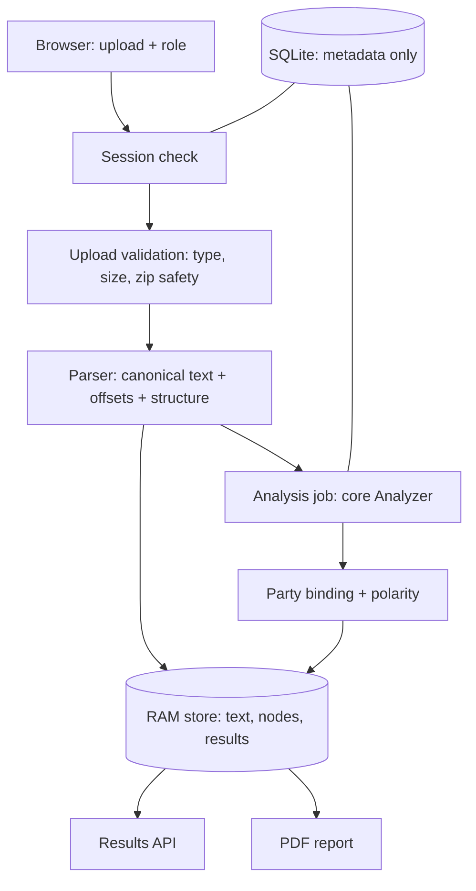

# Backend Architecture

The backend takes an uploaded contract, turns it into one canonical text with exact character offsets, runs the analysis core on that text, applies the user's side of the deal, and serves results to the frontend. It never generates legal text.

This file describes the target design. Sections marked **(planned)** do not exist yet. Update this file whenever the code changes shape.

---

## 1. Request flow



1. The browser creates an anonymous session and gets a bearer token (Phase 2).
2. It uploads one PDF or DOCX and nothing else. The role goes with the party binding, and the scope and `category_ids` go with the analysis request (`Phases.md`, D1).
3. The upload is validated by magic bytes, size and archive safety, then parsed in a child process with a wall-clock kill and a memory cap (planned, Phase 2).
4. The parser returns a `ParsedDocument`: canonical `source_text`, its SHA-256, text blocks with source locators, a structure tree and warnings. The uploaded bytes are dropped.
5. The analysis job passes `source_text` and an `AnalysisContext` to the core analyzer (`AnalyzerProtocol`) from `ml/clauseanchor_core` and gets back category decisions with spans.
6. The backend applies polarity from the user's role and party binding. The core never sees the user's side.
7. Everything text-bearing lives in RAM with a 60-minute TTL. SQLite holds only metadata (ids, statuses, counts, offsets).
8. Every capabilities response, analysis response and report carries the fixed scope notice (Phases.md, "Review scope"). After a complete analysis, the manual-review endpoint (planned, Phase 3) labels each display unit by its overlap with accepted findings, so text without findings is easy to reach.

## 2. Key decisions

| Decision | Choice | Reason |
|---|---|---|
| PDF library | **pdfplumber** (MIT) | PyMuPDF is AGPL, which conflicts with the repo's MIT licence and the hosted demo |
| Offset unit | Unicode code points, `end` exclusive | Matches Python slicing; the frontend converts to UTF-16 |
| Canonical text | Built once, never changed after offsets are assigned | Every highlight, report line and rule flag points into the same string |
| Text normalisation | No Unicode normalisation, dehyphenation or ligature expansion. Three extractor effects remain: PDF runs of spaces collapse to one space, PDF U+00A0 arrives as U+0020, and DOCX `w:noBreakHyphen` becomes ASCII `-` | Keeps `source_text` faithful to the file. Model-side normalisation belongs to the core, which maps its own offsets back. ParserContract.md lists the three effects |
| DOCX auto-numbering | The reader works out each list paragraph's label from its style chain and the numbering part, and carries it as `list_label` in the block locator, with its Word level as `list_level`. It is **not** inserted into `source_text`. A paragraph whose number cannot be worked out keeps its text and raises `NUMBERING_NOT_RENDERED` once per document. 1-E reads `list_label` into `StructureNode.label` | `source_text` stays literal file text; the UI shows labels from nodes. A bullet has no number, so it has no label and no warning |
| Headers, footers, page numbers | Kept in `source_text`, marked as decoration ranges. A PDF line whose middle sits in the top or bottom 8 percent of the page is a candidate, and so is a page number that is the first or last row of the page. A page-number-shaped candidate is decoration at any page count. Any other candidate is decoration when the same line (lowercase, digits as `#`) recurs in the same zone on at least 3 pages and half the pages. Each candidate is a block of its own | Deleting them would shift offsets and hide content. The repetition rule alone misses a one-page file, and a page number on a half-empty page sits outside the margin zone |
| Scanned or partly scanned PDFs | Count characters outside the margin zones. An image-dominant page with fewer than 20 is scanned. When every page with content is scanned, the file is rejected with `SCANNED_PDF`. When only some pages are scanned, the file parses with `coverage.partial = True` and a `PARTIALLY_SCANNED_PDF` warning. An image-dominant page with fewer than 200 also sets `coverage.partial = True`. Widget and FreeText annotations with content set `partial` too. A page where more than a quarter of the glyphs have no text mapping (`(cid:N)` in the text) gets `UNMAPPED_GLYPHS` and sets `partial` | Executed contracts often end in a scanned signature page, so rejecting them would turn away usable files. Margin text such as a Bates stamp does not make a scan readable. A searchable scan (full-page image, large real text layer) must stay usable. `partial` tells the core never to report "not found" for this file |
| PDF content budget | A file of more than 100 pages is rejected with `TOO_MANY_PAGES` before any text is read. Page content streams and Form XObjects decode incrementally, each stream counted once. Decoding aborts at 8 MiB (`MAX_DECODED_CONTENT_BYTES`) with `TOO_MUCH_TEXT` | A 16 KB file can decode to 16 MB and take minutes to extract, so the check must run while decoding. Only Flate streams are measured, behind any leading ASCII85 or ASCIIHex filter, and a stream that names a second growing filter (Flate, LZW or RunLength) is over budget without being decoded. The budget bounds size, not time, so the child-process kill (Worker model) covers the rest |
| PDF reading order and blocks | Words group into rows by `top`. One gutter (at least 12 points wide, at most 40 percent of the rows touch it, text on both sides, right edge in the middle 60 percent of the page) gives bands: lines that cross it stand alone, and each run of column rows reads the left column, then the right. Two or more gutters keep row order and add `MORE_THAN_TWO_COLUMNS`. A crossing line between two column runs adds `COLUMN_ORDER_UNCERTAIN`. A line starts a block when its pitch exceeds 1.3 times the page median, when it begins with a numbering token, or when it returns to the left edge of a block that began there | No model, so every order can be explained. A table with three or more columns reads row by row, which is how a table reads. A page where the parser had to guess carries a warning. The thresholds are named constants in `pdf.py`, and `Phases.md` lists the ceilings |
| PDF errors and logs | The reader catches one closed tuple of library errors and raises `MALFORMED_FILE`. A wrapped wrong-password error raises `ENCRYPTED_PDF`. Every raise uses `from None`. The `pdfminer` and `pdfplumber` loggers are silenced. Layout and assembler calls run outside the try block | Library exception text and log records hold raw document bytes. An empty block from the assembler is a caller bug and stays a `ValueError`, so the catch tuple cannot turn it into a file error |
| DOCX tracked changes | `ins`, `del`, `moveFrom` and `moveTo` in any text part under `word/` are rejected with `TRACKED_CHANGES_PRESENT` | The parser cannot tell which version is the contract. The user accepts all changes and uploads again |
| DOCX text boxes | Every `w:txbxContent` outside `mc:Fallback` is extracted as text blocks right after its anchor paragraph. `TEXT_BOX_CONTENT` is an informational warning and `partial` stays False | Contract text can sit in a text box. Reading the Fallback copy as well would duplicate it |
| DOCX embedded objects | `EMBEDDED_OBJECT` warning and `coverage.partial = True` | The object's content is not extracted, so the core must not report "not found" for this file |
| DOCX unknown block content | The body walk recurses through `sdt`, `smartTag`, `fldSimple`, `customXml` and `hyperlink`. An unknown block-level child, including `altChunk`, is skipped with an `UNSUPPORTED_DOCX_FEATURE` warning and `coverage.partial = True` | Text inside a wrapper must not vanish. A raised error would leave no result to mark partial, so an unknown block is a warning |
| DOCX archive safety | Every member name and method is checked before any member is read. After backslashes become slashes, an absolute path, a drive letter or a `..` segment gives `ARCHIVE_UNSAFE`, and so does a method other than stored or Flate. Each member is then read in 64 KiB steps, and a total over 100 MiB gives `ARCHIVE_TOO_LARGE`. python-docx receives a stored copy. Nothing is extracted to disk. A text part with a DOCTYPE is `MALFORMED_FILE`, and the walk stops with `TOO_MUCH_TEXT` at the 100,001st paragraph of the file | A member name decides nothing about where bytes go, because the parser reads from memory, but a package that names a path outside itself is hostile. The sizes a file declares bound nothing: zipfile inflates a Flate member in one call of up to 1 GiB, and a bzip2 or lzma member with no limit, before it cuts the result to the declared size. Counting the bytes read, and handing the library only stored members, keeps every read bounded |
| DOCX tables and cells | A cell is one `table_cell` block with its paragraphs joined by a newline. A nested table or a text box ends the block, and the text after it starts the next block of the same cell (`segment`). Tables are numbered in preorder across the document | Blocks follow the order of the file, and the text on either side of a nested table stays in blocks of the same cell |
| DOCX headers, footers and notes | After the body come the header and footer variants (default, first, even) of each section, then footnotes, then endnotes. A part is read once and a part whose text repeats an earlier one of the same kind is dropped. Page parts have kind `header` or `footer`, including their table cells and text boxes, so `decorations` covers them. Notes have kind `footnote`, and Word's separator notes are skipped | Contract text sits in headers, footers and notes, and nothing may vanish silently. A part named by every section is read once, so a file with thousands of section breaks costs one read |
| Structure: numbered labels | A label is read at the start of a block, or from the block's `list_label`. It becomes a node only when it continues the sequence at its depth, or starts one at 1, `(a)` or `(i)`. A restart at 1 replaces a run of 3 or fewer and is body text after a longer run. A Word list may open a top-level number above 1, and a Word number above the last one in its sequence continues it. A schedule label clears every sequence. A level is the number of parts of a decimal, plus 1 inside a schedule, and a letter or numeral sits below its parent. A label that is both a letter and a numeral, such as `(i)`, is settled by the Word level in the locator (`list_level`) when there is one | A number inside running text, a cross reference or a party list must not become a clause. Word counts empty numbered paragraphs that the blocks drop, so a gap in a Word list is not a break. One pass with a stack, with no model, so every node can be explained |
| Structure: headings and contents | A short block of capitals (80 characters, every line 60 percent capitals) is an unnumbered level 1 heading that closes open nodes, unless it directly follows a block that is only a label, where it is that label's title. A block with a dot leader, or a one-line block that ends in a page number, is a contents entry and is ignored. A bare number with no full stop is a page number | The contents page repeats every heading, and 1-C does not mark a page number printed mid-page. A title must not close the node it names. A line of redaction marks must not turn a notice into a heading |
| Structure: tables and definitions | An outermost table is one `table` node, and nothing inside it is read as a label or heading. A quoted term followed by `means`, `shall mean`, `has the meaning`, `refers to`, or in brackets as `(the "T")`, is a `definition` node that spans the term with its quotes, one level below the innermost open node or the table | A table has no clause order to read. A definition node lets the core point at the term itself, and the container gives its scope |
| Database | SQLite only, `create_all()`, in memory by default (`CLAUSEANCHOR_DB_PATH`, D8) | Nothing durable is stored; no migrations tool needed. A file would keep session rows and file names on disk until the next start, or after a crash |
| API config | `Settings.from_env` in `config.py` reads `CLAUSEANCHOR_` variables once at start. A bad value stops the start with a message that names the variable and not the value. The session TTL cannot pass 60 minutes. The parser's limits are not settings | One object, no `pydantic-settings`. The promise to users is deletion within 60 minutes, so no setting may break it |
| API errors | One envelope for every error (`api/errors.py`, API.md section 2). A fixed message per code, so request input and exception text never reach a reply. A middleware, not an `Exception` handler, catches a crash and logs only its class name | Starlette's server-error layer sends its reply and then raises again, so the server would log a traceback that holds the exception text (Rules section 5). FastAPI's own 422 body repeats the submitted input |
| Catalogue source | `backend/app/catalogue.json`, loaded once at start by `load_catalogue`, with no ids in the code. A missing or broken file is a reported state: `/ready` says which, and `/capabilities` answers 503 | Tanishq owns the 46 ids. The loader is the one place to change if they later come from the core |
| Worker model | One API process, one bounded analysis worker, one executor thread. Each parse job runs in its own child process with a wall-clock kill and a memory cap (planned, part 2-C) | Fits a laptop and a free host; no Redis or Celery. The kill stops a parse that the content budget cannot bound in time, and the cap stops one it cannot bound in memory. One parse per child, because the DOCX reader changes the process-wide warnings filter |
| User content storage | RAM only, 60-minute absolute TTL | Matches the synopsis promise; nothing on disk |
| Review scope | Fixed category catalogue, a fixed scope notice on every result, no safety score or overall verdict anywhere | The system checks listed categories only. A highlight-free passage is not a safe passage, and the output must never imply it is |
| Completeness | Processing completion, decision coverage and highlight extent are separate fields | Each answers a different question; merging them would read as "share of risk found", which nothing measures |
| Manual-review navigation | Derived in the backend from parser blocks and accepted spans; no new core field | Parser blocks are already exact, non-overlapping units, so the core interface (v2.0) stays unchanged |

## 3. Folder structure

```text
backend/
  pyproject.toml            # package metadata, ruff and pytest config
  requirements.txt          # pinned runtime dependencies
  requirements-dev.txt      # pinned test and lint dependencies
  constraints.txt           # exact versions of all installed packages, transitive ones too (pip -c)
  .env.example              # config names only, no secrets
  .gitignore                # .venv, caches, local db, graphify-out
  app/
    __init__.py
    parsing/                # Phase 1
      __init__.py           # public: parse_document (size check, type, reader, structure tree), ParsedDocument, ParseError, ErrorCode, WarningCode
      model.py              # dataclasses: ParsedDocument, Block, StructureNode, ParseWarning, Coverage
      assemble.py           # TextAssembler: builds source_text and assigns offsets while appending
      errors.py             # ParseError, the fixed error/warning code lists and the limits
      detect.py             # file type detection by magic bytes; the PDF header may sit anywhere in the first 1,024 bytes (pdf_start), and pdf.py cuts the bytes in front of it
      pdf.py                # pdfplumber extraction: error mapping, words to rows to blocks, columns (1-B); decoration, scanned checks, content budget (1-C)
      docx.py               # python-docx extraction: archive checks, tracked-change check, body order, tables, text boxes (1-D); headers, footers, footnotes, numbering (1-D2)
      structure.py          # clause tree from block text and list labels: numbered labels, headings, schedules, tables, definitions (1-E)
      schema.py             # JSON Schema of the output (docs/app/parser_output.schema.json) and to_json, which turns a document into the data the schema describes (with text=False it also drops list_label and sets a definition's label to null)
    scripts/
      parse_file.py         # CLI: parse a local file and print JSON or a summary (dev only); refuses a file over 10 MiB before reading it
    main.py                 # create_app(settings): the app factory. Loads the catalogue, installs error handling, adds the router (2-A)
    config.py               # Settings.from_env: CLAUSEANCHOR_ variables and the API-owned limits (2-A)
    catalogue.json          # (not committed yet) the 46 categories from Tanishq, shape in API.md section 5
    schemas.py              # Pydantic response models (2-A); each later endpoint adds its models
    api/
      errors.py             # ERRORS table, error_response, handlers for 422, 404 and 405, crash containment (2-A)
      routes.py             # health, ready, capabilities (2-A); later parts add their routes
    db.py, models.py        # (planned, 2-B) SQLite metadata
    services/
      scope.py              # SCOPE_NOTICE, Category, Catalogue and load_catalogue (2-A)
      memory_store.py       # (planned) RAM-only content with TTL
      sessions.py           # (planned) capability tokens
      jobs.py               # (planned) bounded queue, progress, cancel
      documents.py          # (planned) upload validation, parse jobs (child process, wall-clock kill, memory cap)
      analysis.py           # (planned) core adapter and result validation
      polarity.py           # (planned, Phase 3) party binding and polarity
      report.py             # (planned, Phase 3) ReportLab report
      review_units.py       # (planned, Phase 3) manual-review display units and overlap labels
    policies/polarity.yaml  # (planned, Phase 3) 46 category policies
  tools/
    annotator/              # (planned, 2-0B) offline annotation tool: runs locally, no network
  tests/
    conftest.py             # session-scoped fixture generation into a temp dir; the API client fixtures on a synthetic catalogue
    synthetic.py            # the made-up catalogue the API tests use (no real id)
    fixtures/build.py       # generates PDF and DOCX fixtures with reportlab and python-docx
    test_assemble.py
    test_pdf.py
    test_docx.py
    test_structure.py
    test_parse.py           # parse_document: every fixture, limits, warning order
    test_contract.py        # JSON form, schema check, CLI
    test_invariants.py      # offset invariant over every fixture
    test_config.py          # Settings.from_env: defaults, every variable, bad values
    test_catalogue.py       # load_catalogue, and the scope notice against Phases.md
    test_errors.py          # the envelope: 404, 405, 422 with no echo, 500 with no exception text
    test_api.py             # health, ready, capabilities and the base path
    test_docs.py            # API.md names every error code and every variable
```

Fixtures are generated at test time, so no binary files are committed.

## 4. Parser output (summary; the full contract lives in ParserContract.md)

```python
@dataclass(frozen=True, slots=True)
class ParsedDocument:
    source_text: str
    text_sha256: str             # sha256 of source_text.encode("utf-8"), lowercase hex
    parser_version: str          # "1.1.0"
    media_type: str              # "application/pdf" or the DOCX mime type
    page_count: int | None       # None for DOCX
    blocks: tuple[Block, ...]    # every text block, in reading order
    nodes: tuple[StructureNode, ...]
    decorations: tuple[tuple[int, int], ...]   # repeated headers, footers, page numbers
    warnings: tuple[ParseWarning, ...]
    coverage: Coverage
```

Party nodes (a requirement from the frontend, `FrontendDesign.md` 17.7, BR). The party list is built from nodes of kind `party`, and each carries `name_span`: `{start, end}` in code points into `source_text`, in the same coordinates as the node's own `start` and `end`, inside that range, covering the party's name alone (`ABC Technologies, Inc.`, not the defining phrase around it). The consumer never cuts a name at a comma, so the parser decides where the name ends. A party node with no span reads as its whole text. Not built: `StructureNode.kind` in `model.py` has no `party` value and no `name_span` field. `ParserContract.md` section 8 carries the field (status: required, not built), and API.md defines it on the document node, tagged `[CONTRACT]` (`Phases.md`, 2-E).

Separators: lines inside a block join with `"\n"`, blocks join with `"\n"`, pages join with `"\n\n"`. Trailing spaces and tabs are stripped from each line before it is appended. CRLF and CR become LF. In PDF text, runs of spaces collapse to one space and U+00A0 becomes U+0020. DOCX text keeps U+00A0.

PDF blocks carry the locator `{"page": n, "block": i}`. Both numbers are 1-based, and `i` counts the blocks within the page. A page lists its top margin lines first, then its body blocks, then its bottom margin lines. `coverage.pages_with_text` leaves out scanned pages, whose only blocks are margin stamps.

DOCX blocks carry one of three locators, with every number 1-based. A body paragraph is `{"part": "document", "paragraph": i}`, where `i` counts all body-level paragraphs, empty ones included. A text box paragraph is `{"part": "document", "textbox": n, "paragraph": i}`, where `n` numbers the text boxes in preorder. A table cell is `{"part": "document", "table": t, "row": r, "cell": c, "segment": k}`, where `t` is the preorder index across all tables and `k` counts the blocks of that cell. DOCX blocks have no page and no box. A numbered paragraph's locator also holds `"list_label"`, the rendered label as text, and `"list_level"`, its Word level.

Headers and footers use `{"part": "header" or "footer", "section": s, "variant": "default" or "first" or "even", "paragraph": i}`, with `s` counting sections from 1. Footnotes and endnotes use `{"part": "footnotes" or "endnotes", "id": n, "paragraph": i}`, where `n` is the note's `w:id`. Tables and text boxes inside these parts add the same keys as in the body, numbered from 1 within each header, footer or note.

Nodes. `StructureNode` holds `id` (`n0001`, `n0002` and on, in order of start and then level), `parent_id`, `kind` (`heading`, `section`, `clause`, `subclause`, `schedule`, `definition` or `table`), `label`, `level`, `start`, `end` and `text`, which is `source_text[start:end]`. A parent holds its children's range and sits at a lower level. A numbered node's kind follows its level, and a heading word, an all-caps line, a schedule, a table or a definition has its own kind. `ParserContract.md` carries the field list and every rule.

## 5. Interface to the core (planned, Phase 2)

The backend imports only public names from `clauseanchor_core`: `CONTRACT_VERSION`, the result dataclasses, `AnalyzerProtocol` and `StubAnalyzer`. It never imports training, extraction or retrieval internals. Contract version **2.0** (multi-span findings) is on `main` (`ml/clauseanchor_core`, Tanishq's commit `d9e4c6a`). Its stub accepts only the fixture text, a parse with no warnings and four category ids, and `AnalysisContext` has no field for `decorations` (`Phases.md`, D6 and D7). The switch is `CLAUSEANCHOR_ANALYZER=stub|real` (built in 2-A). A real run whose artifacts directory is missing fails `/ready` instead of falling back to the stub. Manifest checks come with 4-A. The API `mode` comes from the switch: `stub` gives `sample`.

## 6. Backend tech stack

Python 3.12, pdfplumber (with pdfminer.six), python-docx (with lxml), FastAPI with plain uvicorn (`uvloop` has no Windows build), Pydantic v2, SQLAlchemy 2 on SQLite, ReportLab, PyYAML, pytest, httpx, ruff.

## 7. Frontend

A single-page app in `frontend/` that shows the contract as paper, marks findings in the margin and quotes judgments. It writes no legal text: every string on screen is quoted contract text, quoted judgment text or a short label (DesignSystem.md section 1).

Stack: React 19, Vite 8, Tailwind CSS v4, react-router 8, TypeScript (strict), pnpm. Node 22.18 or later (the tests rely on type stripping, which is on by default from 22.18) and pnpm 10 or later.

### 7.1 Data flow

1. `Start` is three steps, and the step lives in `?step=`. Step 1 creates a session, uploads a file (or a sample id in sample mode) and polls the parse job until the document is ready. Step 2 can open while parsing still runs. `lib/startFlow.ts` holds the state as a pure reducer and says which step it allows. `pages/start/useStartFlow.ts` holds the upload, the polling and the calls to `client`.
2. In step 2 the user picks a role and a party, or "None of these". Neither is preselected. Step 3 sets the scope. `Start` then sets the party binding, starts the analysis job and navigates to `/review/:documentId`.
3. `Reader` polls the job and fetches the analysis as categories resolve, then the manual-review list. It also handles re-binding the party, cancel, retry, report download and delete.
4. Every call goes through `client` in `src/api/client.ts`. Nothing else imports the mock. Today `client` forwards each call to the in-memory mock adapter, which loads on the first call so that the landing page does not carry it. The swap to an HTTP adapter replaces that forwarder, planned for 4-C, and the adapter follows API.md. The mock stays in the production build until then, and that is a release gate: the build is not releasable on it, because it ignores the upload's content and always returns the one sample contract (`FrontendDesign.md` 17.7, BW). 4-C deletes the adapter and the sample contract with the swap and adds a check that `dist` holds no mock: no `mock-*` chunk, no sample contract text and no `example.org`.

### 7.2 Key decisions

| Decision | Choice | Reason |
|---|---|---|
| Data interface | `ApiClient` in `src/api/client.ts`, one exported `client` | The UI is built and reviewed before the API exists, and the swap touches one file |
| Type names | Kept as the mock defines them (`scope_notice`, `catalogue_version`, `processing_complete`, `decision_coverage`, `ReviewUnit`, `ManualReview`, `getManualReview`) | 2-E fixes the final names in API.md and the adapter follows it |
| Client state | React memory only: session token, contract text and job ids in `session.tsx`, theme in `theme.tsx`. Nothing in localStorage, sessionStorage, IndexedDB or cookies | Matches the promise that nothing is stored after the session |
| Offsets | `lib/offsets.ts` builds a code point to UTF-16 table once per text. Every slice of contract text goes through `sliceCp` | Backend offsets are code points and JavaScript strings index UTF-16 code units |
| Routing | `createHashRouter`: `/`, `/start`, `/review/:documentId`, `/how-it-works`, `/accuracy`, `/expired` and a catch-all that shows `NotFound`. Every page except `/` loads on demand. A failing page shows `RootError` inside the shell. `/gallery` is registered only in development, outside the shell | Works on any static host with no rewrite rules. The landing page does not carry the reader, and a bad address is not an expired session. A production build holds no gallery and no preview controls |
| Theming | Tokens are CSS custom properties in `src/index.css`, dark values under `.dark`. The first load follows `prefers-color-scheme` | One set of tokens for every component. DesignSystem.md lists them |
| Fonts | Source Serif 4, IBM Plex Sans and IBM Plex Mono, twelve files in `public/fonts/` (seven Latin and five Latin-extended), with `@font-face` rules, `unicode-range` and metric-matched fallbacks. The two Latin files the first screen needs are preloaded and declared in `index.css`, and the other five Latin faces are in `fonts-late.css`, which `main.tsx` loads after first paint | No request leaves for a third party, which keeps the privacy promise. The rupee sign comes from the Latin-extended files, which the browser fetches only on a page that holds a character in that range (the landing page requests none). Other scripts fall back to a system font (`FrontendDesign.md` 17.2, S, and 17.3, X). Loading five faces after first paint takes 63 KB off the landing page's request chain (17.7, BK) |
| Motion and widths | Tokens in `index.css` (`--ease-out`, `--dur-*`, `--w-*`), one reduced-motion block, route changes through the View Transitions API | One set of values for every part. `DesignSystem.md` 3.5 lists them |
| Start flow | A pure reducer in `lib/startFlow.ts`, a hook for the side effects in `pages/start/useStartFlow.ts`, and the step in the address (`?step=`) | The rules are testable without a DOM. The address owns the step because a second copy in state raced on browser Back. Each upload carries a `seq`, so a late answer for a replaced file changes nothing (`FrontendDesign.md` 6.2 and 17.4, AD) |
| Reader selection | One `choose` function in `pages/Reader.tsx` takes the pick kind (`pointer`, `step`, `activate`). Only a pointer pick runs through `lib/panelTransition.ts`, a view transition of `.reader-panel` with the root left out | Keyboard stepping stays instant and keeps focus on the mark, and the page behind the panel is never captured (`FrontendDesign.md` 17.5, AT and AU) |
| Large documents | `DocumentText` and `TextBlock` are memoised. The findings per block are worked out once, the selected and hovered ids reach only the blocks that hold them, and the pick callback has one identity | A pick or a scroll no longer renders every paragraph. No windowing was needed up to 500,000 code points (17.5, AV) |
| Overlay enters | `.ca-dialog`, `.ca-menu` and `.ca-toast` in `index.css`, with `ca-pop` and `ca-rise` keyframes over the motion tokens. The dialog backdrop is `.ca-enter`. The overlays leave at once, and the one reduced-motion block is their only guard | No motion library and no per-component guard. A test fails if the global rule stops selecting `*` (`FrontendDesign.md` 17.6, BC) |
| Plain pages | `PlainPage` in `components/Layout.tsx` for Expired, NotFound and the error page | One column and one heading style for the three pages that carry no warning colour (17.6, BF) |
| Structure that changes with the width | Both layouts are rendered and CSS shows one (`hidden md:block` and `md:hidden`). `/accuracy` does this: a flat table from 768 px, and the same rows under seven `details` groups below it | The two are sorted differently (across all rows, and inside each group), so they are different DOM. A `useMedia` call in a second lazy page made the bundler split the hook out and pull `StatuteTag` into the entry, 0.64 KB gzipped on every route. The hidden layout is `display: none`, out of the accessibility tree and the tab order (17.7, CL and CM) |
| Links that leave the app | `httpsUrl` in `lib/reader.ts` lets only an `https:` address through to `window.open`, which carries `noopener,noreferrer`. External anchors carry `rel="noreferrer"`, which implies `noopener`. `index.html` sets `<meta name="referrer" content="no-referrer">`, and `public/` has no `robots.txt` | A source address comes from a judgment record, so a `javascript:` or `data:` value must not reach `window.open`. No request leaves the origin, so the policy changes nothing on the wire today and covers the links to come (`FrontendDesign.md` 17.7, BT to BV) |
| Tests | `node --test` over `src/**/*.test.ts`, with type stripping and no new dependency. 68 tests: 9 reveal, 16 tokens (11 colour, 2 reading measure, 2 overlay motion, 1 declared custom properties), 1 font loading, 5 hero fixture, 19 start flow, 3 authority, 11 reader helpers, 2 accuracy (grouping, Weak count), 1 menu (the source sets no inline outline but the forced-state ring), 1 sheet (focus below the peek line opens it) | The pure logic (`lib/reveal.ts`, `lib/offsets.ts`, `lib/startFlow.ts`, `lib/accuracy.ts`, the hero fixture in `pages/landing/heroExamples.ts`) and the colour tokens are testable without a DOM. `tokens.test.ts` reads `index.css` and asserts the contrast pairs |

### 7.3 Folder structure

```text
frontend/
  package.json              # scripts: dev, build, preview, typecheck, test, format
  pnpm-lock.yaml
  tsconfig.json             # strict; the @ alias points to src
  vite.config.ts            # react(), tailwindcss(), the @ alias; Vite defaults (port 5173)
  index.html                # shell: lang, title, meta description, referrer policy, favicon, font preloads, noscript line
  .gitignore                # node_modules, dist, .vite, .screens
  public/
    favicon.svg             # the logomark, with a dark-mode variant
    fonts/                  # twelve woff2 files and the three OFL licence texts
  src/
    main.tsx                # mounts App, loads fonts-late.css after first paint
    App.tsx                 # ThemeProvider, SessionProvider, RouterProvider
    index.css               # fonts, design tokens (light, dark, motion, widths), global focus rule, layout and type classes, reveal, ink-in and hero keyframes, reduced-motion CSS
    fonts-late.css          # the five Latin font faces the first screen can do without, loaded after first paint
    tokens.test.ts          # asserts the contrast pairs of DesignSystem.md 3.1 and the reading measure token against index.css, and that every var() in src names a declared custom property
    fonts.test.ts           # asserts index.css declares only the preloaded Latin faces and fonts-late.css the rest
    api/
      client.ts             # ApiClient interface and the exported client (forwards to the mock adapter, which loads on the first call) and the six mock switches
      types.ts              # API types; offsets are code points
      mock.ts               # in-memory adapter: sessions, job timeline, analysis
      contract.ts           # fictional sample agreement text for the mock
      catalogue.ts          # 46 categories with group, support status and catalogue version
    app/
      routes.tsx            # route table: lazy pages, error boundaries, dev-only /gallery
      Root.tsx              # shell: header, footer, toasts, skip link, focus on route change, dev-only preview controls
      RootError.tsx         # the page shown when a page fails to load or render
      session.tsx           # token, document metadata, toasts, mock settings (memory only)
      theme.tsx             # light and dark
    lib/
      offsets.ts            # code point to UTF-16 table and sliceCp
      useMedia.ts           # media query hook, reduced-motion hook
      reveal.ts             # scroll reveal core: pure, takes the observer as an argument
      reveal.test.ts
      useReveal.ts          # the hook around reveal.ts
      startFlow.ts          # the /start flow as a pure reducer, plus maxReachableStep, clampStep, nextBlocker, parseStep, suggestedParty, partyName
      startFlow.test.ts
      authority.ts          # the one phrase per passage authority status, and the mapping from a free string
      authority.test.ts
      reader.ts             # nearestMark (ruler hit test), freshDelays (row stagger), sessionEndsIn (the session banner line) and httpsUrl (the only addresses a source link opens), pure
      reader.test.ts
      accuracy.ts           # rowVariant (how a row is drawn) and groupRows (the Accuracy rows under the seven catalogue groups, with their Weak counts), pure
      accuracy.test.ts
      panelTransition.ts    # runs a state update in a view transition of the detail panel only
    pages/
      Landing.tsx           # the landing page: hero, sections 1 to 6, closing call to action
      Start.tsx             # the three-step flow: upload, role and party, scope and start
      start/
        useStartFlow.ts     # upload, parse polling and the client calls, reporting to the reducer
        Summary.tsx         # what the user has chosen: the rail list from 1280 px, one line below
      landing/
        HeroDemo.tsx        # the live demo: excerpt, ruler, clause panel, "Next example"
        heroExamples.ts     # typed fixture: three findings from the sample contract, with code point offsets
        heroExamples.test.ts
        Evidence.tsx        # the Evidence section, rendered only when Landing.tsx holds a verified passage (D7)
      Reader.tsx            # the reader: categories, the contract sheet with its ruler, clause detail (docked, or a bottom sheet below 1280 px)
      HowItWorks.tsx        # contents list in the margin, seven sections and Credits, fragments beside the text from 1280 px
      Accuracy.tsx          # measured performance: a ledger table that stacks below 768 px, labelled as an example until real numbers exist
      Expired.tsx           # session ended or contract deleted, on PlainPage
      NotFound.tsx          # the catch-all route
      Gallery.tsx           # component gallery, development only
    components/             # 47 components and icons.tsx: atoms (Button, StatusChip, ...),
                            # molecules (UploadDropzone, ConfidenceBand, JudgmentCard, ...),
                            # organisms (ClauseDetailPanel, CategorySidebar, ReaderToolbar, ...)
      Layout.tsx            # Container, Section, SectionFrame, MarginGrid, PlainPage
      Disclosure.tsx        # native details with a 44 px summary
      Specimen.tsx          # a real component shown beside text: inert, hidden from assistive technology, rises once
      PreviewControls.tsx   # development only: mock switches and the gallery link
```

The FE parts change this tree. Each part updates this section. FE-2 to FE-6 are built and FE-R is closed, and the tree above is as they left it. `FrontendDesign.md` 17.7 holds the FE-R fixes.
